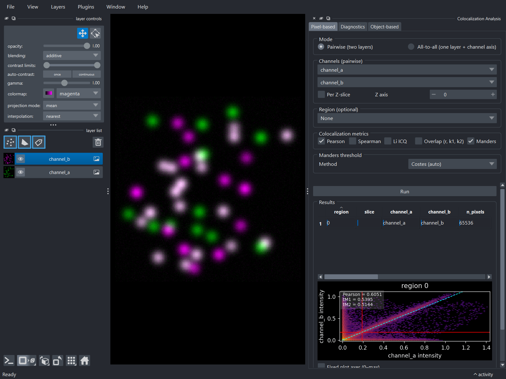

---
hide:
  - navigation
---

<figure markdown="span">
  { width=160 }
</figure>

# napari-colocalization

!!! warning "Under construction - pre-alpha"

    APIs, UI, and outputs may change without notice. Not recommended
    for production analysis yet; use at your own risk and please
    report rough edges via the
    [issue tracker](https://github.com/DBI-INFRA/napari-colocalization/issues).

Interactive intensity-colocalization analysis for [napari](https://napari.org).
Pick two channels (or one multi-channel image), optionally restrict the
analysis to a region drawn as shapes or labels, choose your metric, and get a
results table plus an intensity-vs-intensity density plot - all without
leaving napari.

<figure markdown="span">
  { width=780 }
</figure>

## Features

- **Five colocalization metrics**, both families: three of *correlation* —
  Pearson (PCC), Spearman rank (SRCC) and Li's Intensity Correlation
  Quotient (ICQ) — and two of *co-occurrence* — Manders' overlap coefficient
  with split coefficients (r, k1, k2) and Manders' thresholded coefficients
  tM1/tM2. Pearson and Manders are on by default, one from each family.
- **Pairwise or all-to-all** mode, **2D and 3D**, with optional
  **per-Z-slice** analysis (one row per plane).
- **Region-restricted analysis** via a Shapes or Labels layer - each non-zero
  region is reported on its own row, computed on that region's bounding-box
  crop so masks with many regions stay fast.
- **Manders thresholds**: **Costes auto** (orthogonal-regression bisection,
  matched to Fiji Coloc 2), a per-channel **auto-threshold** (Otsu, Li,
  Triangle, Yen, Mean, IsoData), or **Manual**.
- **Diagnostics tab**: Costes randomization significance test, Van Steensel
  cross-correlation function, and Li intensity correlation analysis.
- **Object-based tab**: centre-particle coincidence and object overlap, with
  centroid Points and nearest-neighbour Vectors drawn into the viewer.
- **Interactive results**: in-widget table with numeric sorting and per-column
  header tooltips, cytofluorogram of the selected row (with optional fixed
  axes), and viewer highlighting / output layers. Plots follow napari's
  light/dark theme.
- **Cancellable runs**: analysis runs on a background thread with a progress
  bar; the Run button turns into **Cancel** while a run is in flight.
- **CSV export** of the current table, plus **figure export** of the plots.

## Installation

```bash
pip install napari-colocalization
```

If napari isn't already installed, install both at once:

```bash
pip install "napari-colocalization[all]"
```

## Where next?

- **[Usage guide](usage.md)** - every control in the widget, in order.
- **[Metrics](metrics.md)** - what the metrics mean, when to use which, how
  the Costes auto-threshold works, and the diagnostics.
- **[Python API](api.md)** - calling the pure-compute layer (`pearson`,
  `spearman`, `li_icq`, `manders`, `overlap`, `costes_threshold`,
  `analyse_pairwise`/`analyse_all_to_all`, plus the diagnostic and
  object-based functions), all importable from `napari_colocalization`
  itself. Reference is auto-generated from the source docstrings.

## Source code

The plugin lives at
[github.com/DBI-INFRA/napari-colocalization](https://github.com/DBI-INFRA/napari-colocalization).
File issues or feature requests on the tracker there. Release-by-release
changes are listed in the
[changelog](https://github.com/DBI-INFRA/napari-colocalization/blob/main/CHANGELOG.md).
